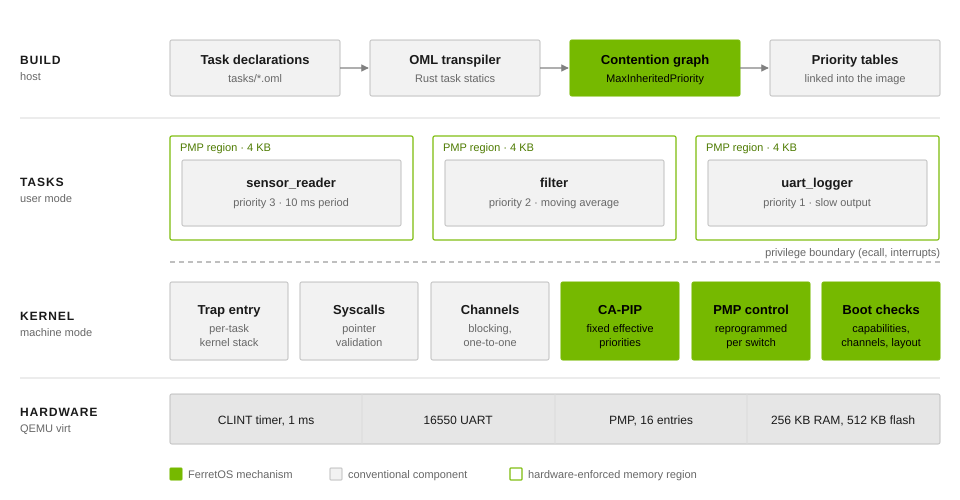
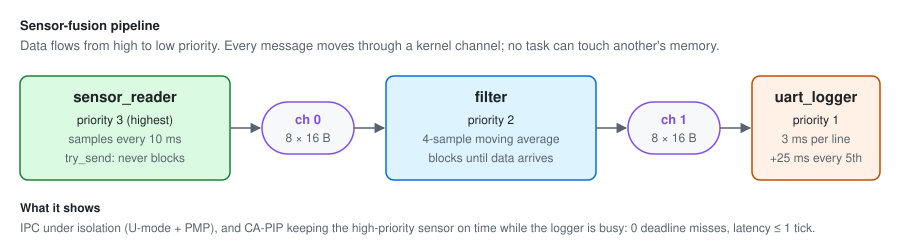
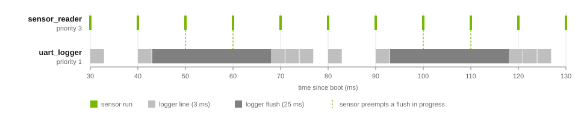

# FerretOS

[](https://github.com/Bilal-Waraich/FerretOS/actions/workflows/build.yml)
[](https://github.com/Bilal-Waraich/FerretOS/actions/workflows/test.yml)
[](https://github.com/Bilal-Waraich/FerretOS/actions/workflows/kani.yml)
[](https://github.com/Bilal-Waraich/FerretOS/actions/workflows/lean.yml)

FerretOS is a research microkernel for small RISC-V systems with no MMU and at most 256 KB of RAM, written in Rust without the standard library. It explores one question in depth: how much of a real-time system's correctness can be decided before the system runs? Task priorities, memory layout, peripheral ownership and communication endpoints are all fixed at build time, checked once at boot, and enforced by the hardware afterwards.

## Motivation

In 1997 the Mars Pathfinder lander began resetting itself shortly after landing. A low-priority meteorological task held a mutex protecting the information bus. A medium-priority communications task preempted it, and the high-priority bus management task, waiting on that mutex, missed its deadline and triggered a watchdog reset [1]. The fix, applied remotely, was to enable priority inheritance [2] on that mutex. It had been available all along and was switched off.

Priority inheritance is a runtime repair: priorities change while the system runs, in response to who happens to be blocked. The Stack Resource Policy [3], used in Rust by RTIC [4], shows that when every resource and every user of it is known in advance, inversion can be prevented statically by assigning each resource a priority ceiling. Most small embedded systems are exactly that static: a fixed set of tasks, compiled into one image, that never changes.

FerretOS takes that observation further and asks whether a full microkernel, with tasks in user mode, hardware memory protection and message passing, can keep the static guarantee. It is built around three questions:

- **RQ1.** Can freedom from priority inversion over shared peripherals be established purely from task declarations, with no protocol running at run time?
- **RQ2.** What does hardware isolation cost on an MMU-less RV32 core, where the only protection mechanism is a small set of PMP registers that must be reprogrammed on every context switch?
- **RQ3.** Can isolated tasks communicate without reintroducing the inversion that RQ1 removes?

## Approach

<p align="center">

<br/><sub><b>Figure 1.</b> FerretOS layers. Green blocks are the mechanisms specific to this work; outlined regions are enforced by PMP.</sub>
</p>

Tasks are declared in OML, a small schema language whose transpiler generates the Rust statics the kernel registers at boot. Each declaration states the task's priority, its memory region, which peripherals it holds exclusively, which it needs, and which channel endpoints it owns.

**Capability-aware priority inheritance (CA-PIP).** From the declarations, the build script constructs a capability contention graph, with an edge L → H whenever task L holds a peripheral that task H requires. For each task it computes the maximum base priority reachable in that graph, and the kernel schedules every task at

```
effective_priority(T) = max(base_priority(T), max over tasks U reachable from T of base_priority(U))
```

This value never changes at run time. A task holding a contended peripheral therefore always runs at least as high as any task that could wait for it, so no intermediate-priority task can run in between. The kernel binary contains no graph code: the build emits a table, and boot copies it. The core property, that a waiter's priority never exceeds its holder's effective priority, is proved in Lean 4 [7] over a model of the graph.

**Isolation.** Tasks run in RISC-V user mode. On every switch the kernel reprograms PMP so that the running task can read and execute flash and read and write its own 4 KB region, and nothing else. Traps are taken on a per-task kernel stack rather than the task's stack, because machine-mode stores are not subject to PMP and a task could otherwise choose where the kernel writes. Every pointer passed to a syscall is checked against the caller's own memory before it is dereferenced.

**Communication.** Since tasks share no memory, channels live in the kernel and messages, up to 16 bytes, are copied in and out. Channels are single-producer, single-consumer, and the boot sequence halts if two tasks claim the same endpoint. `send` blocks when a channel is full and `receive` when it is empty. When a send wakes a receiver of higher priority, the kernel switches to it immediately rather than at the next timer tick.

## Evaluation

The evaluation workload is a three-stage sensor-fusion pipeline (Figure 2). A sensor task samples every 10 ms and publishes with a non-blocking send. A filter computes a moving average. A logger is made deliberately slow: 3 ms of work per line and a 25 ms flush every fifth line, longer than the sensor's period. The question is whether the high-priority sensor stays on schedule while the low-priority logger is busy.

<p align="center">

<br/><sub><b>Figure 2.</b> Evaluation pipeline. Highlighted: the deadline-critical task.</sub>
</p>

Measurements run on QEMU 10.2 `virt` (RV32IMAC). Switch costs and Figure 3 use QEMU's `-icount` mode, which makes runs deterministic, so repeated runs produce identical numbers. The throughput and latency figures come from the boot integration test, which runs in real time. QEMU is not cycle-accurate, so execution cost is reported in retired instructions (`minstret`), not cycles.

<p align="center">

<br/><sub><b>Figure 3.</b> Execution timeline reconstructed from a QEMU run by <code>scripts/plot_timeline.py</code>. Sensor releases at 50, 60, 100 and 110 ms fall inside logger flushes and run without delay.</sub>
</p>

| Metric | Result |
|---|---|
| Samples processed (5 s boot test) | 390, 0 deadline misses, 0 dropped |
| Sensor release latency | ≤ 1 tick (1 ms) for every sample, including those released during a flush |
| Context switch, average / worst | 587 / 817 instructions without PMP; 631 / 861 with PMP |
| PMP cost per switch | +44 instructions on average (+7.5%) |
| Image size | 18 KB flash, 32 KB RAM (of 512 KB / 256 KB) |

Correctness is checked at four levels, all in CI. There are 84 unit tests on the host, among them a cross-check of the build-time graph generator against the in-kernel reference algorithm. Integration tests boot QEMU and assert timing properties from the serial log. One of them makes a task store to a kernel variable and confirms that the store raises an access fault with PMP enabled and succeeds without it. Eleven Kani [6] harnesses verify the graph construction, the conflict detectors, the ready queue and the channel ring buffer for all inputs up to a bound; a bug deliberately seeded into the ring buffer is caught by two of them. The Lean development proves the inheritance property over the graph model.

## Findings

**The guarantee holds for peripherals, and the run-time mechanism disappears (RQ1).** Every scheduling decision is a comparison of two precomputed numbers. Moving the graph computation from boot to build time saved 0 bytes of ROM, because link-time optimisation had already removed the unused code. The benefit is structural rather than a size win: the target cannot run graph code it does not contain.

**Static inheritance has a cost that dynamic inheritance does not.** A task that holds a contended peripheral runs at the inherited priority for its whole lifetime, not only while it uses the peripheral. In the original three-task demo, the low-priority holder runs above the medium task even when it is nowhere near the shared UART. SRP raises priority only for the duration of a critical section. CA-PIP trades that precision for having no run-time protocol at all, and how much response time that costs intermediate tasks is not yet measured.

**Isolation is affordable (RQ2).** Reprogramming two PMP entries per switch adds about 44 instructions, keeping the worst case under the 1,000-cycle budget set in the original design. The subtler cost was in the trap path: until traps moved to kernel stacks, a user task could have chosen where the kernel saves registers.

**Communication reopens the problem (RQ3).** Blocking on a channel is not part of the contention graph. If a high-priority task blocks on a full channel whose consumer has low priority, a medium-priority task can delay the consumer, which is the Pathfinder pattern again with a channel in place of a mutex. The pipeline avoids it by design: data flows from high to low priority and the producer never blocks. A general fix would add channel waits to the graph. Whether that raises priorities too broadly in systems with bidirectional channels is an open question.

**End-to-end tests found what unit tests missed.** Writing a boot test that checked task output, rather than only kernel messages, revealed that the Phase I scheduler never dispatched a task. The demo had been printing its registry and a timer counter all along. The same work exposed a trap handler that lost 144 bytes of stack per interrupt and a PMP feature flag that had never compiled.

## Limitations

The results come from a single emulated platform and one synthetic workload. Instruction counts stand in for cycles, and no measurement has been taken on silicon. The Lean proof covers the scheduling model, not the Rust implementation; the two are linked by tests and by Kani, not by a proof of refinement. PMP isolation is an opt-in feature (`--features pmp`); without it, tasks run in user mode but may access all memory. The system is static by design: there is no dynamic task creation and no capability delegation or revocation.

## Open questions

- How do task response times under CA-PIP compare with SRP on randomly generated task sets, and when does whole-lifetime inheritance hurt?
- Can channel waits be added to the contention graph without raising every task on a bidirectional channel to the same priority?
- Do the instruction counts reported here predict cycle counts on a real in-order RV32 core such as the ESP32-C3? The current plan validates the port in Espressif's QEMU only (see [FerretEvolution.md](FerretEvolution.md)).
- Can OML express typed channel declarations (`sends: Channel(0, Reading)`), so that message types are checked at build time and not only endpoint IDs?

## Reproducing the results

Requirements: `rustup` (the pinned nightly installs automatically) and QEMU with RISC-V support (`brew install qemu`, or `apt-get install qemu-system-riscv` on Debian/Ubuntu).

```bash
git clone --recurse-submodules https://github.com/Bilal-Waraich/FerretOS
cd FerretOS

cargo build --release && ./scripts/run_qemu.sh       # pipeline demo; Ctrl-A X to exit
bash tests/integration/boot_test.sh                  # pipeline timing assertions
bash tests/integration/pmp_fault_test.sh             # isolation test
bash scripts/switch_latency.sh                       # switch cost with and without PMP
python3 scripts/plot_timeline.py                     # regenerate Figure 3
./scripts/host_test.sh                               # unit tests
(cd kernel && cargo kani --default-unwind 17 -Z unstable-options --ignore-global-asm)
(cd lean && lake exe cache get && lake build)
```

`--features pmp` enables per-task PMP isolation. `--features demo-hml` runs the original three-task inheritance demo; check it with `bash tests/integration/boot_test.sh hml`. Implementation notes and the full measurement method are in [docs/internals.md](docs/internals.md), the Phase I design and proofs in [FERRET.md](FERRET.md), and the roadmap in [FerretEvolution.md](FerretEvolution.md).

## Status

Phase I, the scheduler and capability system, was released as v0.1.0. Phase II is largely complete: build-time priorities, user mode with PMP, blocking channels and the pipeline evaluation. A written threat model and a state-machine model of the scheduler in Lean are in progress. Phase III, RV32IMC portability and execution-time analysis in CI, has not started and will be carried out in emulation only.

## Related work

RTIC [4] is the closest relative: it also prevents inversion statically, using SRP, but runs tasks as interrupt handlers in a single privilege domain. Hubris [5] is a static Rust microkernel with MPU isolation and synchronous IPC on ARM. Tock [8] isolates dynamically loaded processes with MPU or PMP. FerretOS combines the static scheduling guarantee of RTIC with the user-mode isolation of the microkernels, on hardware with no MMU.

## References

1. G. Reeves, "What really happened on Mars?", account of the Mars Pathfinder priority inversion, 1997.
2. L. Sha, R. Rajkumar, J. P. Lehoczky, "Priority Inheritance Protocols: An Approach to Real-Time Synchronization," *IEEE Transactions on Computers*, 39(9), 1990.
3. T. P. Baker, "Stack-Based Scheduling of Realtime Processes," *Real-Time Systems*, 3(1), 1991.
4. RTIC: Real-Time Interrupt-driven Concurrency. https://rtic.rs
5. Oxide Computer Company, Hubris. https://hubris.oxide.computer
6. Kani Rust Verifier. https://github.com/model-checking/kani
7. L. de Moura, S. Ullrich, "The Lean 4 Theorem Prover and Programming Language," *CADE*, 2021.
8. A. Levy et al., "Multiprogramming a 64 kB Computer Safely and Efficiently," *SOSP*, 2017.

## Repository layout

Source lives in `kernel/` (the kernel library, boot code and demos), `tasks/` (OML task declarations), `lean/` (proofs), `tests/integration/` and `scripts/`. OML is included as a submodule in `oml/`.
